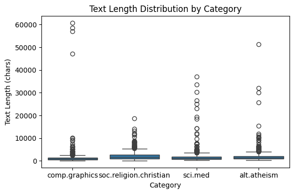
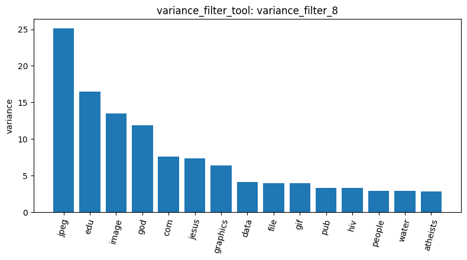
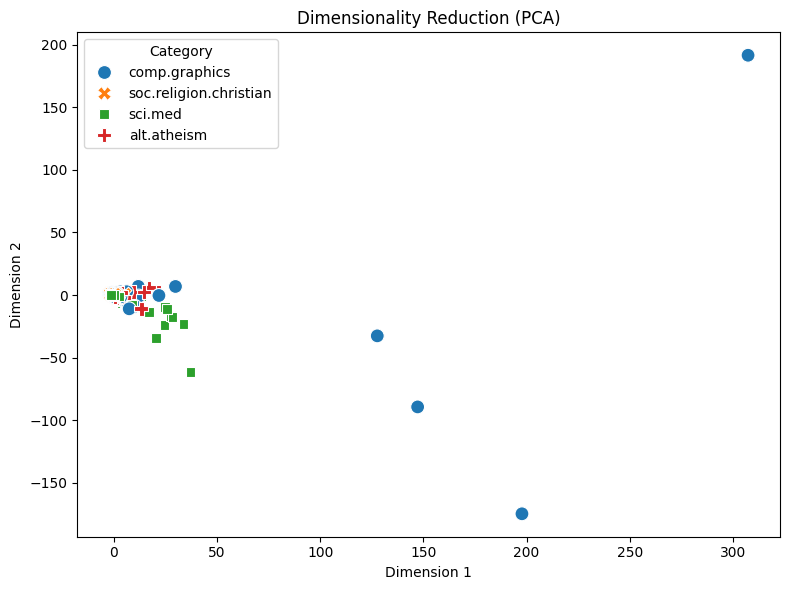

# Lab 1 Agentic Pipeline 報告（20 Newsgroups，4 類）

**資料載入與品質檢查。** 以 `load_dataset_tool` 載入 alt.atheism、soc.religion.christian、comp.graphics、sci.med 四類（`load_dataset_2`），共 2,257 篇，與 Master 一致；各類別為 480、599、584、594 篇。`check_missing_3` 顯示沒有空白或 NaN 文字；`check_duplicates_4`（drop=True，keep=False）找到 0 筆重複，因此沒有刪除任何列。`describe_data_5` 顯示平均長度約 1,993 字元，soc.religion.christian 平均最長（約 2,263 字元）；依 Q3 + 1.5×IQR ≈ 3,955 字元判斷，有大量長文離群值，最長一篇在 comp.graphics，達 60,713 字元。

**DTM 與詞頻。** `dtm_6`（stop_words="english"）得到 35,482 個詞，與 Master 相同，稀疏度 99.68%。`tf_7` 的前 10 名是 edu、subject、lines、god、organization、com、writes、people、article、don，其中多數是郵件標頭與引用格式殘留，而非主題詞。這是整條 pipeline 最重要的觀察：沒有先去除 header/footer，後續所有以頻率為基礎的分析都會被這些詞主導。

**特徵篩選。** `variance_filter_8`（threshold=0.01）保留 5,089 個詞，與 Master 一致，刪掉 30,393 個幾乎只出現在單篇文章的數字、編碼與罕見字。以 comp.graphics 為 one-vs-rest 目標：`pearson_filter_9` 前幾名是 thanks、keywords、looking、vga、video，混入發文習慣用語；`spearman_filter_10` 前幾名則是 graphics、files、image、3d、program，更貼近主題。原因是 Pearson 受少數高計數文章影響大，而 Spearman 只看排序，對極端計數較穩健。下圖為 `visualize_result_tool` 對變異數篩選結果所畫的長條圖。

**頻繁模式、降維與相似度。** `mine_patterns_11`（alt.atheism，tfidf，topk，k=10）挖出的 10 個 pattern 全是 lines、subject、organization、edu 的組合（support 407～480），再次證明標頭詞主導了交易資料庫，沒有反映無神論主題。原本選 sci.med，但其詞彙含非 ASCII 字元，我的 `mine_patterns_tool` 在 Windows 寫暫存檔時沒有指定 utf-8，觸發 cp950 編碼錯誤，這是需要回 AgentDev 修正的實作缺陷。`reduce_dimensions_12`（PCA）的散佈圖如下。`cosine_similarity_13` 中 doc 0 與 doc 1 的相似度只有 0.0582，說明在高維稀疏的原始計數空間中，即使同類文章的詞彙重疊也很少。

**結論。** 數量面的結果（2,257 篇、35,482 詞、5,089 詞）都與 Master 吻合，代表這些 tool 的實作正確；但內容面的結果（tf_7、pearson_filter_9、mine_patterns_11）一致指向同一個問題：郵件標頭沒有清掉。最該優先改進的是前處理，在建 DTM 前移除 header/footer 與引用行，再重跑篩選與模式探勘；其次是修正 `mine_patterns_tool` 的檔案編碼。
