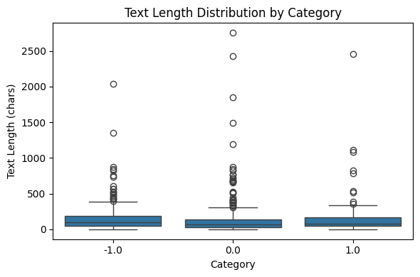
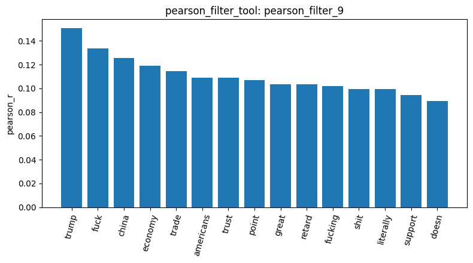
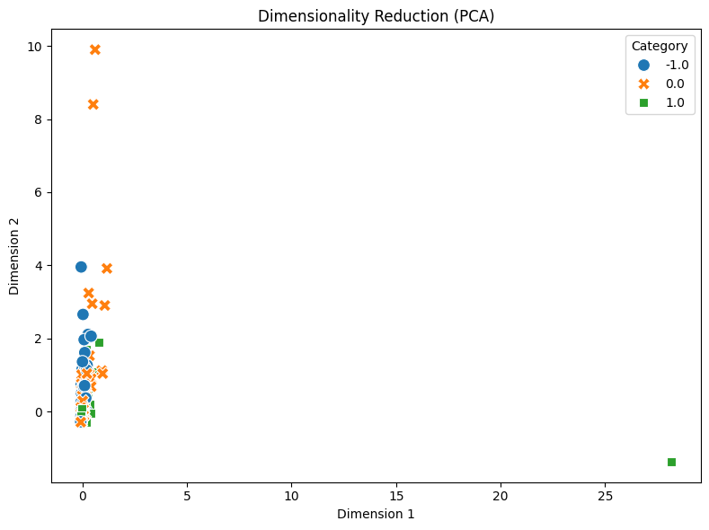

# Lab 1 Homework 報告（Reddit 股市情緒資料）

**資料與清理。** `load_dataset_1` 載入 `newdataset/Reddit-stock-sentiment.csv` 共 847 筆，三個情緒類別為 0.0 中立 423 筆、-1.0 負面 315 筆、1.0 正面 109 筆，類別明顯不平衡，正面只占 13%。`check_missing_2` 沒有缺失值。`check_duplicates_3`（drop=False）找到 23 筆重複，正好對應 847 筆中只有 824 種不同文字；`check_duplicates_4`（drop=True，keep=False）實際刪掉 34 筆，代表這 23 筆多出來的副本來自 11 段被重貼的文字，連同原始那一份一起刪除，剩 813 筆（0.0：391、-1.0：315、1.0：107）。重複幾乎都落在中立類別。20 newsgroups 在同樣的檢查下是 0 筆重複，這是兩份資料第一個明顯差異。

**長度與詞彙。** `describe_data_5` 顯示平均長度 148 字元、中位數只有 80 字元，約是 20 newsgroups（平均約 1,993 字元）的十分之一；正面類別平均最長（166 字元）。`dtm_6` 只有 4,072 個詞，稀疏度 99.71%，與 20 newsgroups 的 99.68% 相近。`tf_7` 的前 10 名是 just、trump、like、china、market 等口語與時事詞，沒有 20 newsgroups 那種 edu、subject 的郵件標頭殘留，也沒有股票代號進入前 10 名。

**特徵篩選。** `variance_filter_8` 用與 20 newsgroups 相同的 threshold 0.01，只留下 340 個詞（8.4%），比 20 newsgroups 的 14.3% 更嚴格。原因是短文中每個詞的出現次數多半是 0 或 1，變異數普遍很小，同一個門檻對短文過於嚴苛，這個參數不能直接沿用。以負面情緒 -1.0 為 one-vs-rest 目標，`pearson_filter_9` 前五名是 trump、fuck、china、economy、trade，`spearman_filter_10` 前五名是 trump、fuck、economy、trade、trust；兩者的 r 都只有 0.11～0.15，遠低於 20 newsgroups 中 graphics 對 comp.graphics 的 0.52，表示單一詞彙對情緒的鑑別力很弱。

**模式探勘、降維與相似度。** `mine_patterns_11`（-1.0，tfidf，fpgrowth，min_sup=10）挖出 trump（45）、china（33）、market（23）、economy（17）、tariffs（16）、xi（11）與 fuck、shit 等詞，負面貼文集中在中美貿易與關稅議題，並夾雜強烈情緒用語；相比之下，20 newsgroups 的同一步驟只挖出標頭詞，Reddit 反而得到有意義的 pattern。`reduce_dimensions_12`（PCA，對 340 個篩選後的詞）前兩個主成分只解釋 12.4% 與 5.0% 的變異，三個情緒類別在圖上嚴重重疊。`cosine_similarity_13`（doc 0 對 doc 3，跨類別）與 `cosine_similarity_14`（doc 0 對 doc 4，同為負面）都是 0.0；短文的詞彙幾乎不重疊，所以詞袋向量無論同類或跨類都量不出相似度。

**與 20 newsgroups 對照的結論。** 同一套 tool 在兩份資料上都能正確執行，但適用性不同：20 newsgroups 的主要問題是郵件標頭汙染，Reddit 則是文字太短、類別不平衡與重貼內容。對 Reddit 而言，詞袋方法在相似度與降維上幾乎失效，變異數門檻也需要依文本長度調低；若要提升情緒分類，應改用 n-gram、TF-IDF 加權或語意向量，並處理正面類別過少的問題。
